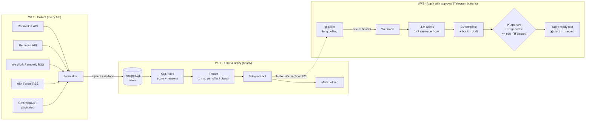

# n8n Job Hunter

Self-hosted system that **collects remote job offers from 5 sources, scores them against a profile, sends
the good ones to Telegram and drafts the application with an LLM — nothing is sent until I approve it**.
Built with n8n, PostgreSQL, Docker and Gemini Flash (any OpenAI-compatible endpoint).

It runs 24/7 on a home server: ~450 offers collected in the first run, ~50 shortlisted automatically,
zero AI tokens spent on filtering (rules first, AI only where judgment is needed).

## How it works



**WF1 – Collection.** One branch per source: download → normalize → save. Each source is isolated
(`continue on error` + retries), so one API being down never stops the others. Offers are normalized to a common
schema and **upserted** by `(source, source_id)`: new offers are inserted, existing ones only refresh their content
and `last_seen_at` — which also tells how long each offer stays published.

**WF2 – Filter & notify.** Deterministic SQL rules classify every new offer as `candidate` or `filtered_out`,
storing a **score** and the **reasons** (e.g. `n8n, español, región ok` or `región excluye Colombia`), so every
decision is auditable and nothing is deleted (the full dataset feeds a market study). Candidates are sent to
Telegram: one message per offer, or a single digest when there are many.

**WF3 – Apply with approval.** Tapping **✍️ Prepare application** on an offer creates a draft: the channel is
detected (email if the offer asks for one, forum DM, or the offer's web form) and the text is built from fixed
CV-based templates plus a **1–2 sentence hook written by the LLM** about the employer's concrete need.
The LLM never writes the rest, so it cannot invent experience; the offer text is passed as *untrusted data*, the
answer is parsed as JSON and stripped of links/emails, and if the LLM fails the draft is still produced without
the hook. I can approve, regenerate, discard or edit by replying to the message; after sending, **📤** records
`sent_at` so response rates can be measured. Telegram updates arrive through **tg-poller**, a tiny dependency-free
long-polling container (read-only, no capabilities, no ports) that forwards to n8n over the internal Docker
network with a secret header — **n8n is never exposed to the internet**.

| Signal | Points |
|---|---|
| Mentions n8n | +50 |
| Automation in the title / Zapier, Make, Power Automate | +25 |
| JavaScript / Node / TypeScript / React | +20 |
| Java / Spring | +20 |
| Spanish and no English requirement | +20 |
| AI / agents / LLM in the title | +10 |
| Explicitly open to LATAM / worldwide | +10 |

Hard filters: region must include Colombia, no Staff/Principal/Lead roles, published in the last 30 days,
and forum posts must be actual job offers (not "for hire" posts).

## Engineering highlights

- **Workflows as code.** Normalizers are plain JavaScript in `scripts/normalizers/`, covered by unit tests
  (`node --test`, 16 tests with real fixtures). `scripts/build_wf1.js` embeds them into n8n Code nodes and
  generates the workflow JSON — the JSON in git is always generated, never hand-edited. Same for the application
  templates and LLM guardrails (`scripts/applications/`, 7 tests).
- **n8n API client.** `scripts/n8n.sh` (curl + jq) lists, pulls, pushes, activates workflows and summarizes
  executions per node in a few lines — no clicking through the UI to deploy or debug.
- **Failure handling.** Per-source isolation, retries, batching (1 request / 1.5 s) for paginated APIs,
  in-memory dedupe before the upsert, tolerant parsers that skip bad records instead of failing the run.
- **Storage-aware.** Raw records are kept for reprocessing but stripped of duplicated HTML and logos
  (table went from 3.2 MB to 1 MB with no information loss).
- **Security.** Secrets only in `.env`; ports bound to `127.0.0.1`; containers that process untrusted web content
  get no Docker socket and no host home access; all external text is HTML-escaped before reaching Telegram;
  credentials are imported into n8n without ever being written to disk.

## Stack

n8n · PostgreSQL 17 · Docker Compose · JavaScript (Node.js) · SQL · Bash · Telegram Bot API · Gemini (OpenAI-compatible API)

## Run it

```bash
cd infra
cp .env.example .env          # fill in passwords/keys (openssl rand -hex 32)
docker compose up -d          # n8n on http://localhost:5678
docker compose exec -T postgres psql -U n8n -d jobs < sql/001_offers.sql
docker compose exec -T postgres psql -U n8n -d jobs < sql/002_classification.sql
docker compose exec -T postgres psql -U n8n -d jobs < sql/003_applications.sql
cd ..
node --test scripts/normalizers/ scripts/applications/   # tests
for wf in 1 2 3; do node scripts/build_wf$wf.js; done
scripts/n8n.sh push n8n/workflows/wf1-recoleccion.json   # same for wf2 / wf3
```

More details in [`docs/INFRA.md`](docs/INFRA.md). Some code comments and docs are in Spanish.

Every workflow is self-documented in the n8n canvas: a header note, one colored note per stage and a short note under each node.

## Structure

```
infra/          docker-compose, SQL schema and migrations, tg-poller
n8n/workflows/  generated workflow JSON (WF1 collect, WF2 filter & notify, WF3 apply with approval)
n8n/sql/        upsert and classification queries
scripts/        normalizers + tests, application templates + tests, workflow builders, n8n API client
```

## Author

**Jhon Alexander González** — n8n & AI automation developer, Colombia (UTC-5).
[LinkedIn](https://www.linkedin.com/in/jhon-alexander-gonz%C3%A1lez-ram%C3%ADrez-a28803232/)

License: MIT
